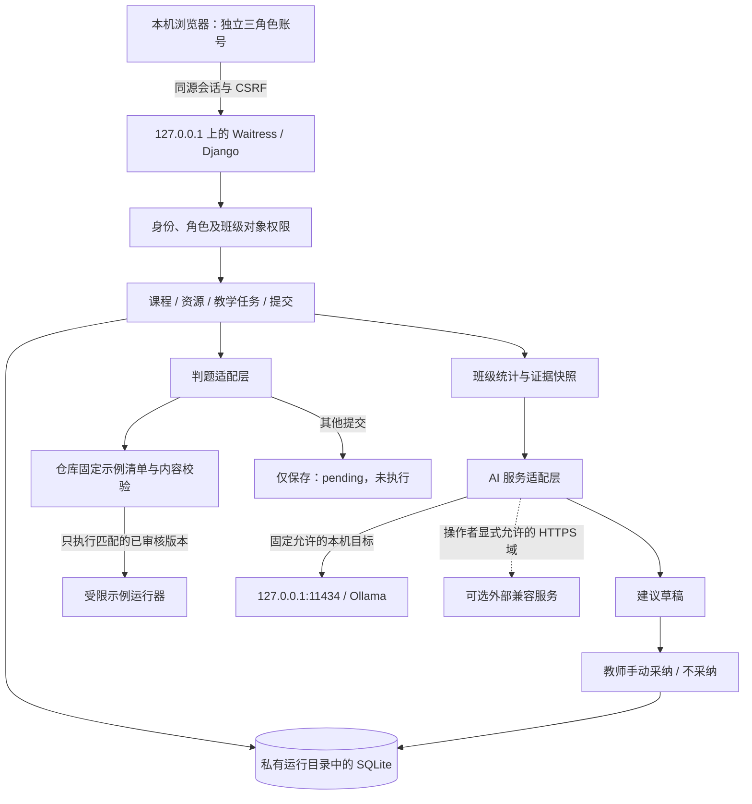

# CourseLoop 技术选型与安全架构

设计基线：2026-10-22。适用范围：18:00 前的本机教学闭环演示。

本文规定应实现的架构与安全要求，不构成已实现、已测试或已通过安全审计的声明。实际结果由独立验证记录给出。需求依据见[需求确认记录](需求确认记录.md)，验收条件见[功能范围与验收](04_功能范围与验收.md)。

## 1. 决策与适用边界

采用 Django 5.2.18 LTS、Python 3.14.6、SQLite、Waitress 3.0.2，构建同源的本机单体应用。Django 负责账号、会话、权限、CSRF、数据访问和教学业务；SQLite 保存模拟数据；Waitress 仅监听 `127.0.0.1`。API 密钥以 cryptography 50.0.2 提供的加密能力保存，精确依赖以最终锁定文件为准。该版本替换了依赖审计发现含已知安全公告的初选版本。

这项决定成立的前提是：一人在同一台 Windows 电脑以独立管理员、教师、学生账号轮流演示，数据均为模拟数据，不承担真实考试、正式成绩或多人并发服务。SQLite 的便利不能推导为已经具备学校生产环境的容量或高可用性。

Django 官方当前将 5.2.18 列为 5.2 LTS 补丁版本，扩展支持至 2028 年 4 月；5.2 系列自 5.2.8 起支持 Python 3.14。选择受维护分支，减少临时拼接身份与会话逻辑的工作。[Django 下载与支持周期](https://www.djangoproject.com/download/)、[Django Python 兼容范围](https://docs.djangoproject.com/en/5.2/faq/install/)

Waitress 官方说明其可运行于 Windows。本项目选择它承载本机 WSGI 应用，不将开发服务器当作正式部署方案；版本兼容与启动行为仍须在目标机器验证。[Waitress 官方文档](https://docs.pylonsproject.org/projects/waitress/en/stable/)

## 2. 架构与信任边界

GitHub Pages 继续承载公开交互原型与本机使用说明。它提供静态网站托管，不能运行这里的 Django、数据库或 AI 后台。公开网页不能保存密钥，也不直接请求用户电脑上的 Ollama。[GitHub Pages 官方说明](https://docs.github.com/en/pages/getting-started-with-github-pages/what-is-github-pages)

## 3. 身份、权限与浏览器边界

- 使用服务端会话和独立账号；登录后的角色取自服务器，不能由前端请求自行声明。
- 管理员管理账号、班级、课程和 AI 配置；教师只处理所属课程、班级及对应提交；学生只读取获授权任务和自己的提交。每次访问对象时检查关系，隐藏按钮不是鉴权。
- 写入操作均要求身份、权限和 CSRF；退出登录必须使会话失效。登录错误不泄露账号是否存在；凭证猜测须有节流措施。
- 首期监听地址、Host 校验和同源校验共同限制访问；禁止为方便演示改为 `0.0.0.0`、通配 Host 或允许任意跨域。
- 本机 HTTP 的会话策略只适用于回环地址。迁移到学校服务器前，必须启用 HTTPS 并重新验证 Cookie、代理、Host 和来源配置，不能直接复制本机例外。
- 页面按文本呈现用户内容与模型输出；禁止将代码、资源正文或 AI 文本直接解释为 HTML。

本机登录不能抵御已控制操作系统账号的攻击者。三角色分离证明的是应用权限边界，不是同一电脑上的物理隔离。

同样，本机密钥与数据库都保存在运行目录时，加密主要降低单独泄露数据库的风险；获得整个运行目录或操作系统账号的人仍可能获得解密材料。学校版本须另行落实独立密钥管理与文件访问控制，不能把“已加密”作为全部泄露风险的结论。

## 4. 代码执行：本期最关键的限制

本期真实运行仅限仓库内固定、已审核的示例版本。执行前要核对题目与示例映射和内容；参数、标准输入、输出量、时间均需限制。界面必须显示执行类型与证据来源。

任意编辑代码、教师新建代码、上传代码、AI 生成代码、点击“审核”后的代码，都不能获得本机执行资格。它们只保存为 `pending`，明确说明“已保存，尚未执行和评分”。结果为空不是零分，不能伪造通过结果。固定示例清单的修改属于仓库代码变更，需要重新审阅和验证。

时间限制、Python 受限启动参数、静态检查或普通子进程均不能单独构成任意代码沙箱。本期不声称具备安全运行任意学生代码的能力。学校版本必须替换为独立隔离判题服务，完成文件、网络、资源、凭证和进程逃逸边界的验证后，才能开放任意提交执行。

## 5. AI 配置、密钥与请求约束

本期优先给教师生成班级共性错误与教学建议，学生聊天暂缓。输入来自已授权班级的实际提交和判题汇总；模拟的是班级数据身份，聚合和模型调用必须是真实过程。

Ollama 提供部分 OpenAI 兼容接口，本项目以兼容的聊天接口为适配边界，不假设所有协议功能完全等同。[Ollama 兼容接口说明](https://docs.ollama.com/api/openai-compatibility)

- 只有管理员能保存地址、模型名和密钥；读取配置只返回“是否已设置密钥”，不返回密钥原文。
- 本机服务仅允许明确的 `127.0.0.1:11434` 目标和既定 API 路径；不因其为本机部署而开放其他端口或地址。
- 可选外部服务必须由运行系统的操作者显式允许域名，并使用 HTTPS；管理员界面不能绕过运行配置的允许范围。
- 地址解析拒绝凭证、异常端口、混淆地址和重定向。连接目标还需符合网络允许规则；外部域不能借 DNS 变化访问回环、私网、链路本地或云元数据服务。
- 限制输入、响应大小和等待时间；网络失败返回明确失败状态。不得静默换到外部模型，或用预设内容冒充本次 AI 成功结果。
- 密钥加密后存库，解密材料单独保存在本机私有运行目录，真实密钥启用前须移出 OneDrive 等同步目录；不进入 Git、日志、网页和公开部署。密钥丢失时须重新配置，不能以明文兜底。
- 模型输入和输出均是不可信文本；它们不能触发代码执行、配置更改、任务发布或自动修改成绩。建议仅在教师手动确认后记录为采纳。

这些 URL 规则采用允许清单思路，并禁止自动跟随重定向。它们需要针对实际客户端实现验证，不以“已做 URL 校验”代替 SSRF 验收。[OWASP SSRF 防护指南](https://cheatsheetseries.owasp.org/cheatsheets/Server_Side_Request_Forgery_Prevention_Cheat_Sheet.html)

## 6. 数据与故障处理

运行数据、数据库、可能的资源文件及本机密钥统一放入私有运行目录，默认位置为 `.runtime`，可通过不含密钥的本机操作人配置迁出同步目录；不进入仓库。默认只接收本期模拟数据。资源附件通过私有存储和鉴权下载访问，不能临时开放任意文件上传。

关键操作应保留操作者、对象、动作、时间与结果；日志不记录密码、Cookie、API 密钥或完整模型请求。审计日志用于追踪，不能宣称能抵御本机文件管理员篡改。

- 判题失败保留提交，展示失败原因；不自动判零或通过。
- AI 超时或模型不可用保留确定性统计，教师仍能查看任务和提交，AI 区域显示未生成或失败。
- 数据库写入使用事务，失败时不得显示保存成功；对 SQLite 锁冲突给出可重试提示，不无限重试。
- 保留上一次生成报告时，必须标注时间与证据范围，不能把旧报告显示为刚生成。

备份应在停止应用后复制运行目录，或使用 SQLite 在线备份机制获得一致数据库。数据库与加密材料分别保护；恢复时使用相配的备份并验证账号、教学数据和 AI 配置可用性。首次备份和恢复演练仍属验收事项，本文不声明其已完成。

## 7. 本期明确否决的方案

不采用公网暴露本机后台、浏览器保存 AI 密钥、直接运行任意 Python、AI 自动定正式成绩、只在前端限制角色、用成功页面替代真实持久化。也不为本次单人演示提前引入多服务部署或分布式组件；学校迁移另设准入条件。
