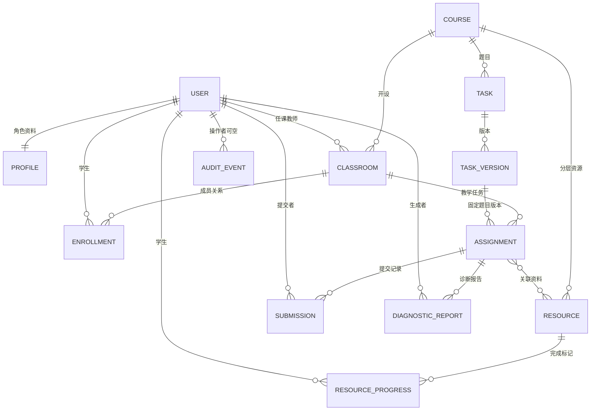

# CourseLoop 数据模型

设计基线：2026-10-22。本稿字段与 `server/teaching/models.py` 的首期定义对齐；代码定义存在不代表迁移、约束和业务流程已通过验证。

## 1. 建模原则

首期使用 Django 关系模型与 SQLite。账号、课程和班级是权限基础；资源、题目、教学任务、提交和报告不能脱离这些关系。应用不得根据前端传来的角色、学生标识、分数或 AI 服务地址决定权限与可信结果。

下述实体是本期数据范围。学习知识图谱、赛事和正式四维成绩属于扩展设计，不预先插入空表宣称已实现。

`AIConfig` 为本机单实例配置，与报告通过配置版本和模型名建立追溯，不在报告中复制密钥。

## 2. 账号、课程与班级

### User / Profile

账号采用 Django 用户模型，密码使用框架的密码字段与校验机制，不另建明文密码表。`Profile` 通过 `user` 一对一关联，保存 `role` 与 `display_name`。角色值为 `admin`、`teacher`、`student`。

应用角色与 Django 后台管理权限不是可任意互换的概念；实际入口必须检查其所需条件。角色变更只能由授权管理员执行，不接受登录表单或普通接口自行指定。

### Course / Classroom / Enrollment

- `Course`：`slug` 唯一，另有 `title`、`description`、`language`。首期数据为 Python，不把语言写成不可变全局常量。
- `Classroom`：关联 `course`、`teacher`，保存 `name`。当前是一班对应一门课程、一个任课教师；教师组、跨班共享和同班多课教学组织后续再评审。
- `Enrollment`：连接 `classroom` 与 `student`，数据库唯一约束为二者组合，避免重复入班。

课程和任课教师被班级保护引用。成员关系删除不能被误当作删除历史成绩或历史提交的授权。

## 3. 资源与完成标记

### Resource

字段包括 `course`、`created_by`、`title`、`level`、`kind`、`body`、`url`、`file`、`original_filename`、`is_published`、`created_at`。

- 资源层级 `level`：`basic`、`comprehensive`、`contest`，分别为基础巩固、综合开发、竞赛备赛。
- 类型 `kind`：`video`、`slides`、`worksheet`，分别为微课、课件、实训任务单。
- `is_published` 默认假；学生可见范围还必须结合课程归属与发布状态判断。
- 正文上限为 40,000 字符；URL 上限为 500 字符。附件字段的存在不代表任意格式可上传；格式、体积、存储位置、鉴权下载由入口验证。
- 附件存储名由服务端生成，原文件名单独作为不可信显示文本保存，不能作为磁盘路径使用。

### ResourceProgress

关联 `resource`、`student`，保存 `completed_at`，二者组合唯一。它代表学生完成标记，不等于实际观看时长、知识掌握度或客观学习成效。首期不据此虚构练习时长。

## 4. 题目版本与教学任务

### Task / TaskVersion

`Task` 保存 `course`、`title`、`level`、`knowledge_points`。当前知识点为 JSON 标签列表，不是已经建成的关系型知识图谱。当前 `level` 沿用资源的三层分类，用于教学组织；后续“基础 / 进阶 / 项目”学习阶梯必须另行明确映射或字段，不能直接宣称两者等价。

`TaskVersion` 保存 `task`、`number`、`prompt`、`starter_code`、`fixture_key`、`created_at`。题目与版本号组合唯一；题目说明上限 30,000 字符，初始代码上限 20,000 字符。

教学任务引用确定的题目版本。题目变化创建新版本，不能覆盖旧提交所依据的说明。本期模型在常规 `save()` 路径禁止修改已创建版本的主要字段；这不是数据库层不可篡改保证，其他写入口也必须遵守。

`fixture_key` 只关联仓库中的固定示例组。数据库新增或修改该值不能注册新执行代码，源代码的执行资格由仓库清单与内容校验决定。

### Assignment

字段包括 `classroom`、`task_version`、`title`、`stage`、`status`、`due_at`、`resources`、`created_by`、`created_at`。

- `stage`：`before`、`during`、`after`，即课前、课中、课后。
- `status`：`draft`、`published`、`closed`，即草稿、已发布、已关闭。
- `resources` 为多对多关系；关联资源、题目版本与班级必须属于同一课程，不能只检查其标识存在。
- 草稿不向学生开放；提交资格还须检查发布状态、成员关系与截止规则。

阶段是教学流程标签，不能由服务器当前时间自行推断。时间在存储层采用时区感知值，显示采用 Asia/Shanghai；无截止时间与已过期必须区分。

## 5. 提交与判题证据

### Submission

字段包括 `assignment`、`student`、`source`、`source_hash`、`status`、`score`、`passed`、`total`、`result`、`fixture_id`、`request_id`、`created_at`。

提交保留原任务与学生关系，源代码上限为 20,000 字符。`source_hash` 和判题字段由服务器生成，不接受客户端提交可信结果。`student` 与 `request_id` 组合唯一，用于识别重复请求；去重范围和发生重复时的响应要在接口实现中保持一致。

- `pending`：已保存、未运行；`score` 应为空，不能按零分处理。
- `completed`：固定示例实际运行完成，`passed`、`total`、`score` 与用例摘要一致；该分数仅为教学演示结果。
- `error`：评测过程失败，提交仍保留；不得伪造通过或将基础设施错误当作学生零分。

`result` 保存状态说明和用例摘要；`fixture_id` 记录命中的固定示例版本。它们不代表未来隔离沙箱返回结构已经冻结。提交一经产生，学生不可通过普通编辑请求改变原记录及其结果。

## 6. 报告、配置与审计

### DiagnosticReport

字段包括 `assignment`、`created_by`、`status`、`evidence`、`content`、`error_message`、`model_name`、`config_version`、`adopted_at`、`created_at`。

`status` 为 `completed` 或 `failed`。`evidence` 保存本次班级汇总快照，必须区分已评与待评、无数据与零值，并说明重复提交统计口径。生成后新增提交不应悄悄改写旧报告的依据。

报告内容与证据分开：证据是确定性聚合，内容是模型建议。`model_name` 与 `config_version` 用于追溯调用配置；不保存密钥。`adopted_at` 为空表示尚未采纳。采纳动作的操作者应通过审计记录可追踪，不能把生成者默认当作所有后续操作的操作者。

### AIConfig

保存 `label`、`base_url`、`model`、`encrypted_key`、`timeout_seconds`、`version`、`updated_at`。本期写入约定固定主键为 1，是本机配置，不是课程级或学校级多租户配置。

密钥只以加密形式存库；加密材料在 `.runtime` 中独立保护。读取配置返回是否已设置密钥，不能返回密文或明文。配置改变需要可追踪版本，报告保存生成当时版本；超时范围和地址允许规则由服务层严格校验。

### AuditEvent

保存可空 `actor`、`event`、`object_type`、`object_id`、`details`、`created_at`。账号移除时审计主体引用置空，事件本身保留。`details` 只存必要元数据，禁止密码、密钥、会话和完整模型输入。

该记录不是防篡改账本。正式学校部署仍需定义保留周期、导出权限和独立日志保护。

## 7. 一致性与统计要求

模型字段的 `choices`、表单校验、数据库唯一约束和对象权限是不同层次；存在枚举字段不代表数据库自动阻止全部非法写入。所有入口要验证角色、同课程关系、状态和长度，关键写入使用事务。

班级报告先明确统计对象再聚合：是全部提交还是每生最新提交、待评是否排除、失败用例如何计数。重复提交不能在无提示时扩大“多少学生犯错”的人数。正式成绩模型尚未建立，本期不把演示分数合并成正式课程总评。

备份与恢复要求见[安全架构](01_技术选型与安全架构.md)。模型及迁移变动需要同步本文与[接口契约](03_接口契约.md)，但不反向修改旧验收结果。
