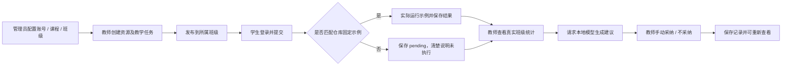

# CourseLoop 功能范围与验收

设计日期：2026-10-22。演示目标时间：当天 18:00 前，时区 Asia/Shanghai。

本文为计划验收条件，不是通过记录。每项结果应由实际操作、接口检查或自动检查提供证据；失败项保留状态和原因，不通过删改标准制造“全部通过”。

## 1. 第一版交付范围

一台电脑、一个操作者、三个独立账号、模拟大学 Python 程序设计课程。后端仅在 `127.0.0.1` 使用。第一优先领域为“教”，为其提供必要的学生任务与提交链路。课程和班级通过数据关系识别，不能写死为全局唯一。

### 教：本期真实业务

管理员配置模拟账号、课程、班级和 AI 服务。教师管理三层资源：基础巩固、综合开发、竞赛备赛；资源可以是微课信息、课件内容、任务单或受控链接，不把链接条目宣称为已建成媒体存储系统。

教师围绕课前、课中、课后组织任务并发布。学生读取所属班级任务并提交 Python 源代码。仓库固定示例可以实际运行并生成用例结果；其他代码保存待评，明确没有运行和分数。

教师读取本班实际保存的提交和结果，查看共性错误统计，调用本地 Ollama 生成教学建议，再手动采纳。教师采纳不等于模型结论被证明正确，也不自动改变任务、代码或成绩。

### 学：支撑教学的必要部分

本期提供学生登录、任务查看、代码提交与结果回看。完整个性化路径、知识图谱推断、学生 AI 聊天和深度能力画像后续建设。现有原型若展示这些功能，必须继续标注演示来源。

### 赛与评：保留设计和原型入口

保留周赛、月赛、校级赛以及四维评价的产品结构和扩展契约。本期不承诺真实赛事调度、正式总评、相似度服务或监考。静态赛评原型的数据不能混入本机真实教学统计，不能伪装成新后端提供的结果。

## 2. 必须演示的闭环

“真实”表示账号、权限、持久化、聚合和服务调用确实发生，全部输入仍使用模拟人员和示例内容。报告须区分已评与待评，不能把待评提交计入错误率或当零分。

## 3. 功能验收条件

1. **账号与权限**：管理员、教师、学生分别登录退出；刷新仍遵循会话；学生直接访问教师、管理路径被服务端拒绝。教师不能访问不属于自己的班级，学生不能读取他人提交。
2. **课程与班级**：资源、任务、成员和提交均有明确归属；至少通过一个不相关班级的对象访问检查，不能依靠首期只有一个班掩盖越权。
3. **三层资源**：能创建、保存和查询三层资源；内容刷新后保留；权限外不可修改；特殊字符作为文本显示。
4. **教学流程**：任务可标注课前、课中、课后阶段；草稿不向学生开放；发布后所属班级可见；无权限用户不能发布。
5. **真实提交**：源代码提交后持久保存，回看时仍关联原任务与学生。无效输入给出具体错误，失败操作不显示成功。
6. **固定示例评测**：不同预设示例产生实际用例结果并保留执行类型、状态和必要证据；评测对象与任务相符。
7. **任意代码拒绝执行**：修改固定示例、提交新代码、改变教师输入，均只能进入待评；状态、结果和界面清楚表达未执行，不虚构分数。
8. **统计口径**：教师汇总来自本班数据库记录；展示总提交、已评、待评的分母口径；重复提交的统计规则明确；没有记录时显示无数据。
9. **真实 AI**：使用管理员配置调用本地模型；报告关联生成时班级、任务及统计证据；无数据时不臆造班级问题；失败时显示失败，不能改用模板冒充生成。
10. **教师采纳**：建议默认未采纳，由有权限教师操作；采纳记录有人员和时间；学生、其他班教师和模型本身不能执行采纳。
11. **持久化**：重启应用后账号、教学记录、提交和采纳状态仍可读取；重置样例须为明确的管理操作，不能在启动时覆盖现有数据。
12. **公开入口说明**：博客及 GitHub Pages 只介绍原型和本机使用方法，明确真实服务需在本机启动；不发布后台、数据库、账号密码或密钥。

## 4. 安全与故障验收条件

- 未登录、角色越权、跨班访问、缺失 CSRF 的写请求都被拒绝；错误响应不泄露堆栈和凭证。
- 登录猜测具备限速；上传和正文请求有大小上限；渲染资源、代码、模型响应时不执行其中脚本。
- AI 配置读取不返回密钥；普通用户不能更改服务地址；被禁止的目标地址和重定向不能访问。
- `.runtime`、数据库、加密材料和可能的附件不被版本跟踪，也不能通过静态路径下载。
- 人为停止 Ollama 后，教学和提交仍可使用，报告区域清楚显示故障；恢复后由用户主动重试。
- 任意代码不会被本机运行器接收。固定示例运行异常不能令请求无限等待或产生无限输出。
- 完成一次一致性备份和恢复检查，验证数据与加密配置的处理结果；没有恢复证据时不能宣称备份可靠。
- 监听范围保持回环地址，不添加公网隧道，不将演示临时变成多人在线服务。

以上项目涉及的具体检查方法与结果另记。设计条目存在不等于相关防护已经实现。

## 5. 演示材料与边界说明

准备一门模拟课程、一个主要演示班、三层样例资源、三阶段任务和少量固定示例。样例人数用于看清数据关系，不用于证明承载能力；另备无数据、待评及 AI 失败状态。

现场说明应包含：“本期实现教学闭环；使用模拟数据；真实判题只执行仓库固定示例；其他代码待评；AI 是教师可复核的建议；竞赛与综合评价仍为原型或后续接口；暂不形成正式成绩。”

若关键安全项未满足，保留可安全展示的部分并明确缺口。不能为演示进度临时放开任意代码执行、网络访问或权限检查。
